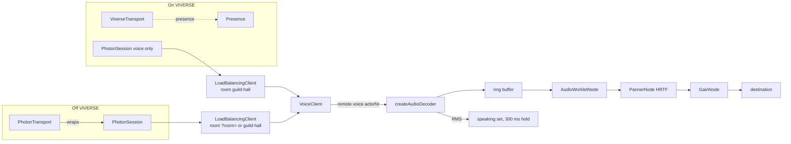

# feat: Replace LiveKit with Photon Voice (spike) and rebuild the VIVERSE upload

## Summary

Swap LiveKit for Photon Voice in `guild-hall-library`, following `guild-hall-library/docs/PHOTON-VOICE-SPIKE.md`. Remote voices decode to PCM and play through our own HRTF panners. Off VIVERSE, one Photon room carries presence, chat, controls and voice. On VIVERSE, presence stays on `ViverseTransport` and Photon carries only voice. The run ends with a rebuilt `guild-hall-library-viverse.zip` that replaces the build now uploaded to VIVERSE.

**Delivery constraint (user-directed):** this run makes no commits and no pushes. All changes stay uncommitted in the `spike/photon-voice` worktree.

---

## Problem Frame

Today voice (and off-VIVERSE presence) depends on LiveKit Cloud plus a Cloudflare token worker. The spike tests whether Photon Voice can deliver spatial voice with no server of our own, on desktop Chrome and Quest Browser. Quest Browser is not on Photon's supported list, so a manual go/no-go runs before the Hall is changed.

---

## Requirements

- R1. Remote voices are spatial: each one plays through the existing `PannerNode` settings, including the stage roll-off (spike doc, Step 4).
- R2. The public voice surface used by `src/social.ts` and `src/main.ts` stays the same: `micOn`, `setMic`, `muteLocal`, `localMuted`, `speaking`, `updatePanners`, `updateSubscriptions`, `ensureAudio`, `disconnect`.
- R3. Off VIVERSE, `PhotonTransport` carries state, chat and controls. Senders are checked: state and chat must match the sender's `pid`, and controls must come from the master client.
- R4. On VIVERSE, `ViverseTransport` keeps presence, and `PhotonSession` joins a Photon room for voice only. Voices map to presence ids through the actor property `pid`.
- R5. LiveKit is gone from code and dependencies: `src/net/livekit.ts`, `src/stubs/livekit.ts`, `proxy/livekit-token-worker.js` and `livekit-client` are removed. The deployed Worker and `proxy/wrangler.json` are left alone.
- R6. The single-file artifact build still builds, with a Photon stub in place of the LiveKit stub.
- R7. Pass criteria 1–7 from the spike doc's Step 6 are checked by hand on desktop and Quest.
- R8. A new `guild-hall-library-viverse.zip` is built from `dist/`, with `index.html` at the zip root and both App IDs taken from `.env.local`.
- R9. User-facing docs and copy stop describing LiveKit: the `index.html` privacy line, `README.md`, `MULTIPLAYER.md`, `DEPLOY.md`, and the `VIVERSE.md` checklist.

---

## Key Technical Decisions

- KTD1. **Photon only, with no provider switch, no fallback and no token worker.** (session-settled: user-directed — chosen over switchable voice providers (branch `feat/voice-providers`): reach working spatial voice directly.) Governs R5.
- KTD2. **On VIVERSE, presence stays on VIVERSE and Photon carries voice only.** `src/main.ts` pairs `ViverseTransport` with `PhotonSession` the way it pairs it with `LiveKitSession` today. `src/net/viverse.ts` is not edited. (session-settled: user-approved — chosen over Photon for presence on VIVERSE too: the user's choice, which keeps the current VIVERSE split.) Governs R4.
- KTD3. **Off VIVERSE, one `LoadBalancingClient` carries everything, and the master client is the host.** `?hostKey` is removed. (session-settled: user-directed — chosen over the LiveKit token attribute `host=1`: no server side, and host messages can't be spoofed.) Governs R3.
- KTD4. **The VIVERSE upload is rebuilt as part of this work.** (session-settled: user-directed — chosen over testing only on a plain HTTPS host: the user is replacing the live VIVERSE build.) Governs R8.
- KTD5. **`PhotonSession` owns the `LoadBalancingClient`, and `PhotonTransport` wraps it.** This mirrors how `LiveKitTransport` wraps `LiveKitSession`, so the VIVERSE path (session only) and the off-VIVERSE path (session plus transport) share one connection class. The session exposes a generic event hook (code, content, actorNr), and the transport translates event codes 1, 2 and 3 into `TransportEvents`.
- KTD6. **On VIVERSE the Photon room is always `guild-hall`.** It is not tied to the VIVERSE overflow room (`guild-hall-2`, …), because aligning them would mean editing `viverse.ts`, which KTD2 rules out. With the free plan's 20 CCU cap, overflow voice rooms are moot for the spike.
- KTD7. **Playback path:** `createAudioDecoder` → a per-voice ring buffer → one `AudioWorkletNode` per voice → `PannerNode` → `GainNode` → destination. The worklet module is a small file served unhashed from `public/`, so the multi-file build and the zip can load it. The single-file build never reaches the voice path (it uses the stub). The `AudioContext` is created at 48 kHz.
- KTD8. **Nearest-10 culling disconnects audio nodes but leaves Photon subscriptions alone.** `updateSubscriptions` keeps its scoring rule (lifted unchanged from `livekit.ts`). It uses the result to connect or disconnect each voice's panner chain, because the JS API has no per-voice subscribe.
- KTD9. **No unit-test runner is added.** The package has only `typecheck`, and adding a test framework is outside the spike. Proof comes from `npm run typecheck`, both builds, a two-tab local check against Photon Cloud, and the manual device gates.
- KTD10. **How the SDK is shipped depends on its license.** If redistribution is allowed, the SDK goes in `guild-hall-library/vendor/photon/` with its license. Otherwise that folder is gitignored and the download is documented. Either way, the loader injects a script tag (the pattern in `viverse.ts`), and the file is copied into the build output so the VIVERSE zip contains it.

---

## High-Level Technical Design

Voice keys: Photon gives `actorNr`, and the rest of the app keys by presence id. Each session sets its own actor property `pid = presence.self.id` on join and keeps `actorNr ↔ pid` maps, updated on actor join, property change and leave. A voice that arrives before its actor's `pid` is known is held, and it attaches once the mapping appears.

---

## Implementation Units

### U1. SDK intake and the Step 1 go/no-go (manual gate)

**Goal:** Confirm that Photon's unmodified `demo-voice-basics` works between two desktops and between a desktop and a Quest before the Hall is touched.

**Requirements:** R7 (gate). KTD10.

**Dependencies:** The user has created the Photon Voice app, downloaded the SDK into `guild-hall-library/scratch/photon-sdk/`, and added `VITE_PHOTON_APP_ID` to `.env.local`.

**Files:** `guild-hall-library/scratch/photon-sdk/` (read only, gitignored). The App ID goes into the demo's `cloud-app-info.js` inside `scratch/`, never into a tracked file.

**Approach:**
1. Read `license.txt` and record the vendor-or-gitignore outcome for U2.
2. List the SDK's files. Record its version, whether `.wasm` or worker files are present, and the decoder's output format if the SDK source shows it.
3. Serve the demo over HTTPS on the LAN (or on localhost, with `adb reverse` for the Quest). Ask the user to run the three device checks from Step 1.

**Execution note:** This is a manual gate. If Quest Browser fails, stop the run and report to Photon, as the spike doc says.

**Test expectation:** none — this is environment setup and a manual device check.

**Verification:** The user reports two-way audio between two desktops and between a desktop and a Quest, and whether there is echo on speakers.

### U2. Load the SDK into the Hall

**Goal:** Make `globalThis.Photon` available to the app in dev, in `dist/`, and in the VIVERSE zip, and stub it out in the single-file build.

**Requirements:** R6. KTD7, KTD10.

**Dependencies:** U1.

**Files:**
- Create `guild-hall-library/src/net/photon.ts` (the loader; it later holds the session and transport classes).
- Create `guild-hall-library/vendor/photon/` (or a `.gitignore` entry for it).
- Create `guild-hall-library/src/stubs/photon.ts`.
- Modify `guild-hall-library/vite.config.ts`.
- Copy any WASM or worker files into `guild-hall-library/public/photon/`.

**Approach:**
- Mirror `loadScript` in `src/net/viverse.ts`.
- Serve the SDK file unhashed from `public/photon/` so Vite copies it into `dist/`.
- In single mode, alias `./net/photon` to the stub. The stub keeps the same exports but throws "Voice is not available in this preview build".
- Remove the `livekit-client` alias.

**Patterns to follow:** `src/net/viverse.ts` `loadScript`; the stub style in `src/stubs/livekit.ts`.

**Test expectation:** none — this is packaging. Verify with a smoke check.

**Verification:** `npm run dev` loads the script, and `Photon.LoadBalancing` is defined in the console. `npm run build` puts the SDK file in `dist/photon/`. `npm run build:single` succeeds.

### U3. `PhotonSession`: connection and voice

**Goal:** Spatial Photon voice behind the same surface as `LiveKitSession`.

**Requirements:** R1, R2, R4. KTD5, KTD6, KTD7, KTD8.

**Dependencies:** U2.

**Files:**
- Modify `guild-hall-library/src/net/photon.ts`.
- Create `guild-hall-library/public/photon/voice-worklet.js`.

**Approach:**
1. **Connect:** `connect(pid, name)` creates the `LoadBalancingClient` with the App ID, connects to the region master, and joins or creates the room with `maxPlayers: 20`. On join it sets the actor property `pid` and keeps the `actorNr ↔ pid` maps. Status strings follow `LiveKitSession`.
2. **Voice client:** create the transport and voice client, then register the remote-voice action. For each remote voice, create a decoder whose frames go into that voice's ring buffer and into the RMS speaking detector.
3. **Mic:** `setMic(true)` creates the microphone and the local voice. `setMic(false)` disposes both so the browser's mic indicator turns off. If U1 found echo, capture the mic with `getUserMedia` (echo cancellation, noise suppression, auto gain), run it through an AudioWorklet, and send it with `pushData`.
4. **Playback chain:** worklet, then panner, then gain, as in KTD7. `muteLocal` sets the gain to 0. `updatePanners` is lifted from `livekit.ts` unchanged. `updateSubscriptions` reuses the scoring rule from `livekit.ts` and connects or disconnects chains (KTD8).
5. **Data hook:** expose a generic `send(code, obj, reliable)` and `onEvent(code, content, actorNr, pid)` for U4.
6. **Disconnect:** close every chain, leave the room, and set `micOn = false`.

**Patterns to follow:** `LiveKitSession` in `src/net/livekit.ts`, for the surface, the panner settings and the scoring rule.

**Test scenarios** (manual, two Chrome tabs on one machine against Photon Cloud, the second tab with its output muted or on headphones):
- Tab A mic on: tab B hears A within about 1 s, and A's speaking ring lights in B.
- Tab B walks away from A: the volume falls. Tab A steps onto the stage: B hears A across the hall.
- Tab B uses Mute on A: silence in B only. Tab A's mic stays live in other tabs.
- Tab A mic off: the browser's mic indicator turns off in A, and B's ring for A goes dark within about 0.3 s.
- Tab A closes: B tears down A's chain, with no console errors.
- A voice arrives before its `pid` is known: it attaches once the actor property arrives.

**Verification:** `npm run typecheck` passes, and every scenario above behaves as described.

### U4. `PhotonTransport`: presence, chat and controls off VIVERSE

**Goal:** Carry presence, chat and controls over Photon events, with sender checks.

**Requirements:** R3. KTD3, KTD5.

**Dependencies:** U3.

**Files:**
- Modify `guild-hall-library/src/net/photon.ts`.
- Modify `guild-hall-library/src/net/types.ts`: `kind` becomes `'viverse' | 'photon' | 'sim'`.

**Approach:**
- Event codes: 1 state (unreliable), 2 chat (reliable), 3 control (reliable).
- Accept state only when `payload.id` matches the sender's `pid`, and chat only when `payload.from` matches it.
- Accept controls only when the sender's actorNr equals `myRoomMasterActorNr()`.
- An actor leaving calls `onLeave(pid)`.
- `isHost()` compares this client's actorNr with the master's.

**Patterns to follow:** `LiveKitTransport` in `src/net/livekit.ts`.

**Test scenarios** (manual, two tabs):
- Both tabs see each other's avatars move and receive each other's chat.
- The first tab to join is the host. A seating change from it applies in the second tab.
- A control sent from the non-host tab (forced from the console) is ignored.
- A state message whose `id` names another peer is ignored.
- When the host tab closes, the remaining tab becomes master and `isHost()` returns true.

**Verification:** Avatars and chat work between two tabs, and the spoofed messages are rejected.

### U5. Wire up `main.ts` and remove LiveKit

**Goal:** Route both hosting modes through Photon and delete LiveKit.

**Requirements:** R4, R5. KTD1, KTD2.

**Dependencies:** U3, U4.

**Files:**
- Modify `guild-hall-library/src/main.ts`.
- Modify `guild-hall-library/package.json` and `guild-hall-library/package-lock.json`.
- Delete `guild-hall-library/src/net/livekit.ts`, `guild-hall-library/src/stubs/livekit.ts` and `guild-hall-library/proxy/livekit-token-worker.js`.

**Approach:**
- `LIVEKIT_TOKEN_URL` becomes `PHOTON_APP_ID`, read from `VITE_PHOTON_APP_ID`.
- The VIVERSE branch connects `ViverseTransport`, then `PhotonSession` on `guild-hall`.
- The non-VIVERSE branch connects `PhotonTransport` on `?room=` or `guild-hall`.
- The `?hostKey` handling and the `LiveKitSession` type import are removed. The sim branch is unchanged.
- If the Photon join fails on VIVERSE (for example, at the CCU cap), presence stays connected and the dock shows a voice status message.

**Test scenarios:**
- No App IDs set: the "Preview a crowd" sim still works.
- `?sim=20`: the sim still works.
- Only the Photon ID set: Photon presence plus voice.
- Both IDs set, on VIVERSE: VIVERSE presence plus Photon voice.

**Verification:** `npm run typecheck` passes. `npm run build` and `npm run build:single` succeed. `grep -ri livekit src` returns nothing.

### U6. Docs and user-facing copy

**Goal:** Remove LiveKit from the docs and copy, and document Photon setup.

**Requirements:** R9.

**Dependencies:** U5.

**Files:** `guild-hall-library/index.html` (privacy line), `guild-hall-library/README.md`, `guild-hall-library/MULTIPLAYER.md`, `guild-hall-library/DEPLOY.md`, `guild-hall-library/VIVERSE.md`.

**Approach:**
- Replace the LiveKit environment variable and token-worker steps with `VITE_PHOTON_APP_ID` and the SDK download.
- Update the `VIVERSE.md` pre-publish checklist: a Photon App ID instead of the LiveKit worker.
- Keep a note that the `guild-hall-voice` Worker is still deployed and that tearing it down is a separate decision.

**Test expectation:** none — docs only.

**Verification:** No stale LiveKit setup instructions remain, except the note about the Worker that is still deployed.

### U7. Build the VIVERSE zip and run the device tests (manual gate)

**Goal:** Produce the replacement upload and check the Step 6 pass criteria.

**Requirements:** R7, R8. KTD4.

**Dependencies:** U5, U6.

**Files:** `guild-hall-library/dist/` (rebuilt) and `guild-hall-library/guild-hall-library-viverse.zip` (rebuilt). Neither is committed in this run.

**Approach:**
1. Copy `.env.local` from the main checkout into the worktree without reading it.
2. Run `npm run build`, then zip the contents of `dist/` with `index.html` at the root, per `VIVERSE.md`.
3. Check that the zip contains the Photon SDK file and the worklet, and no `livekit` chunks.
4. Desktop to Quest test over USB: `npm run dev` plus `adb reverse`.
5. The user uploads the zip to VIVERSE Studio and repeats the key checks on VIVERSE.

**Test scenarios:** the spike doc's Step 6 pass criteria 1–7, run by the user. Record mouth-to-ear latency, Quest frame rate with voice on and off, and any console errors.

**Verification:** The zip builds with no LiveKit assets. The user reports the pass/fail results.

---

## Scope Boundaries

- No stress testing (Tier 1–3 and `?simVoices`) and no interest groups.
- No changes to `src/net/viverse.ts`.
- No teardown of the `guild-hall-voice` Worker or `proxy/wrangler.json`.
- No commits, pushes or PR in this run.

### Deferred to Follow-Up Work

- Tying the Photon room to the VIVERSE overflow room name, once a paid CCU plan makes it matter.
- The open questions for Photon listed in the spike doc.

---

## Risks & Dependencies

- **The SDK download is gated (found 2026-10-16).** Photon Voice JavaScript SDK 4.4.0 carries an "Industries Circle" badge on photonengine.com/sdks. The download returns 403 "exclusive to Circle Members" for a free account. U1 cannot start until the account has Circle access or Photon provides the SDK another way.
- **Quest Browser support is unconfirmed.** U1 is the gate.
- **The decoder's output format is unknown** (sample rate and channel count). The worklet resamples if it differs from 48 kHz. The non-spatial `createAudioPLayer` is a temporary diagnostic only.
- **VIVERSE hosting might block WebSocket connections to Photon Cloud through a CSP.** The LiveKit build reached `*.livekit.cloud`, which suggests outbound WSS is allowed. This is checked in U7.
- **The 20 CCU free cap:** VIVERSE rooms hold up to 120, so voice joins beyond 20 fail cleanly while presence keeps working (U5).
- **`dist/` is tracked in git**, so rebuilding it leaves a large uncommitted diff in the worktree. That's expected under the no-commit constraint.

---

## Verification Contract

- `npm run typecheck`, `npm run build` and `npm run build:single` all pass in `guild-hall-library/`.
- The two-tab scenarios in U3 and U4 pass against Photon Cloud.
- The manual gates (U1, U7) are reported by the user.

## Definition of Done

- U2–U6 are implemented, and the verification contract passes.
- `guild-hall-library-viverse.zip` is rebuilt, without LiveKit, and handed to the user for upload.
- Nothing is committed or pushed.
