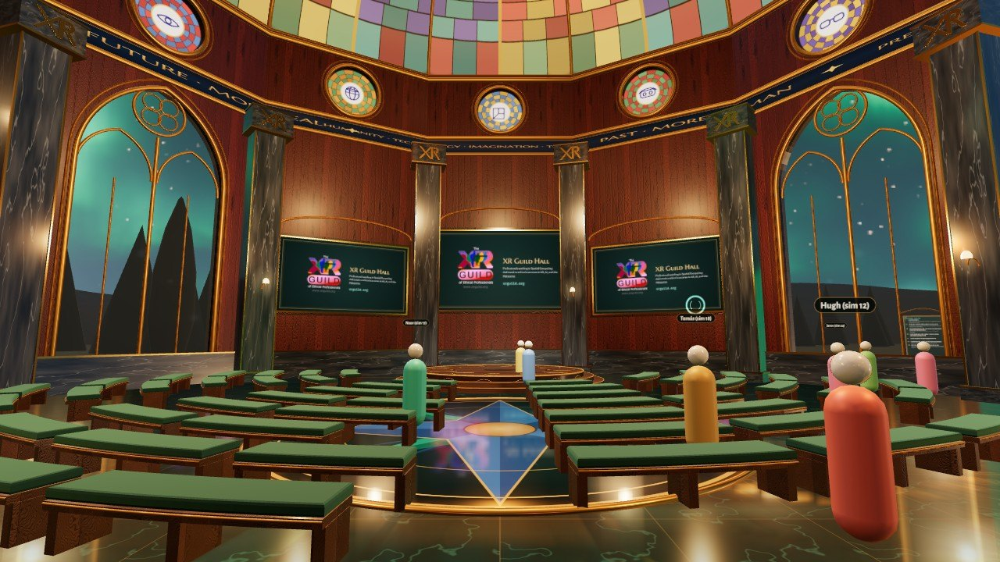
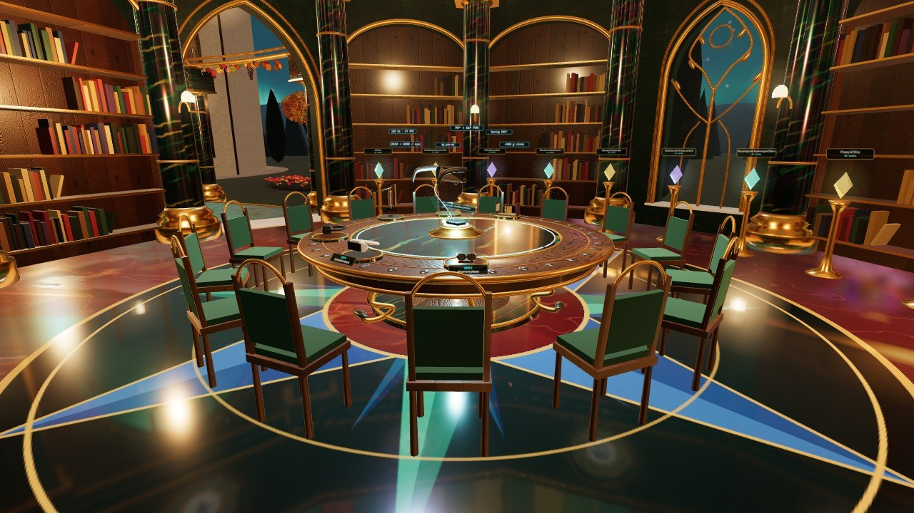
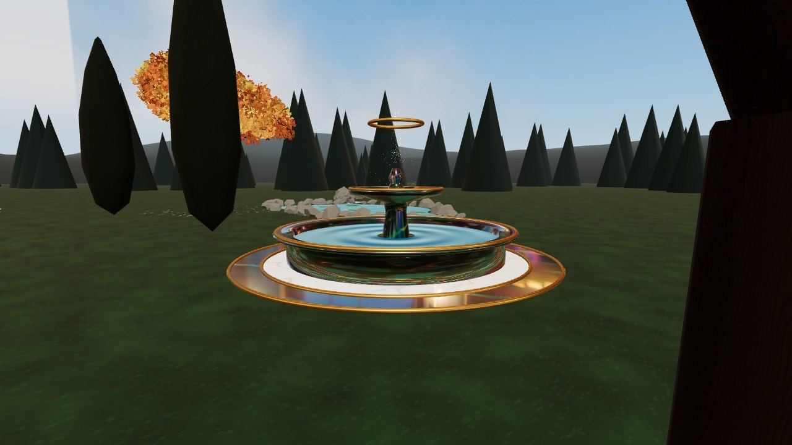
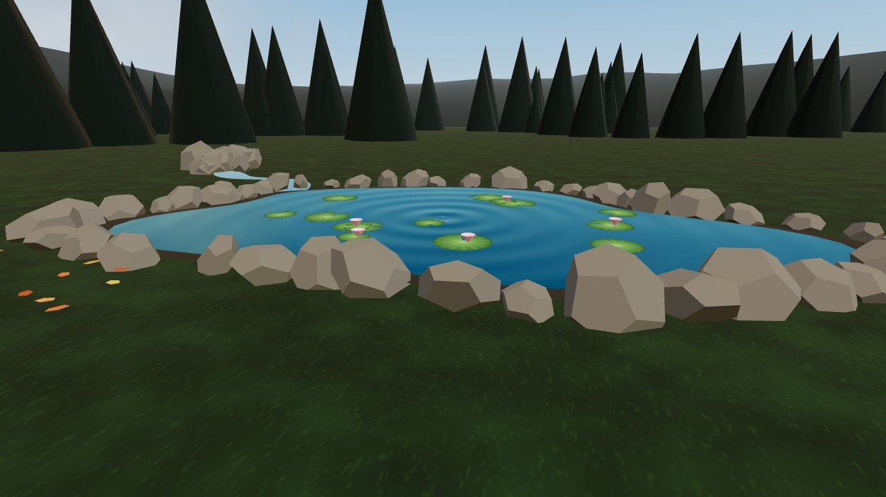
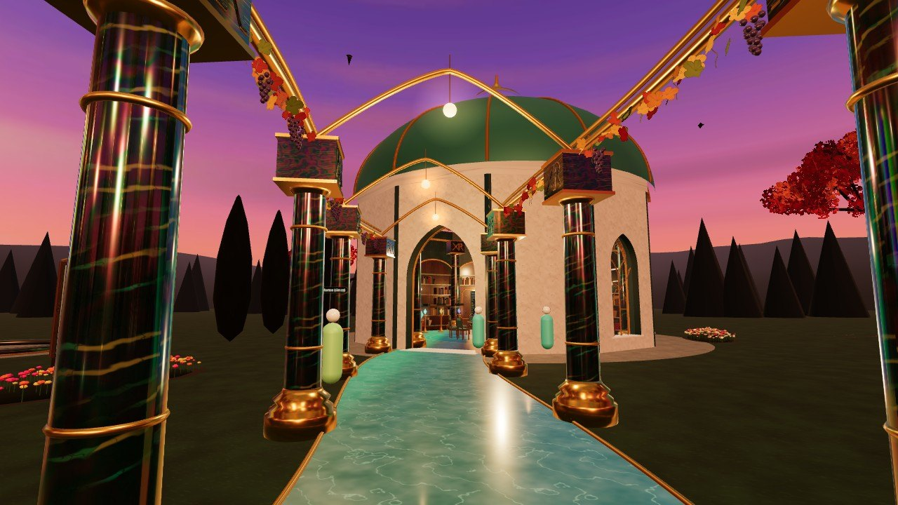
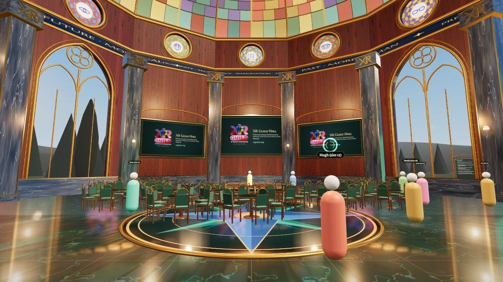
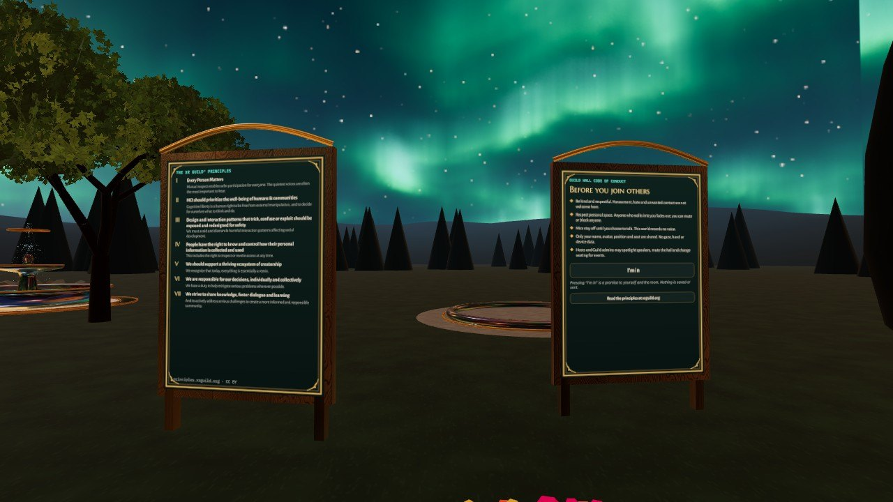
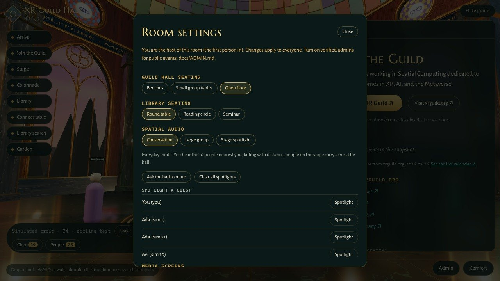
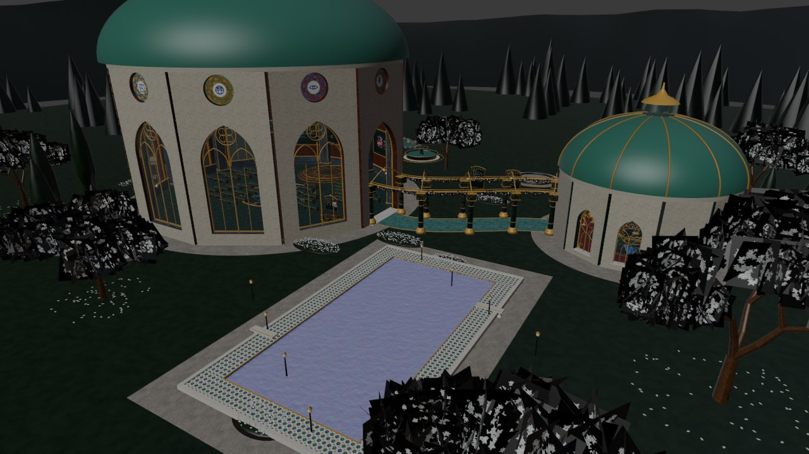

# XR Guild Hall V3 for VIVERSE

V3 takes the Guild Hall that opens at Immersive X (Thu 12 Nov 2026) and packages it for VIVERSE, with spatial audio for large groups, admin room settings, stream screens and screenshare, and the garden additions from the Arrival.space build. It runs the same in any browser and headset (desktop, phone, Quest, Pico).

Branch: `v3/viverse`, built on Patrick's `spike/photon-voice` (Photon voice, megaphone, load-test bots), so all of that work is kept.

## What's new in V3

| Area | What it does | Where |
|---|---|---|
| **Admin room settings** | Admin menu (bottom right): hall seating, library seating, audio mode, spotlight, mute the hall, media screens. Late joiners get the current settings. Verified admins via Photon Custom Authentication. | `src/room.ts`, `src/admin.ts`, [docs/ADMIN.md](docs/ADMIN.md) |
| **Hall seating** | **Benches** (curved, backless, the V3 standard, up to 200) · **Small group tables** (4 to 6 a table, up to 120) · **Open floor** (dances and events). | `src/seating.ts` |
| **Spatial audio** | Photon Voice with HRTF. Modes: **Conversation**, **Large group**, **Stage spotlight**; plus Patrick's stage megaphone and admin spotlight for any guest. | `src/net/photon.ts`, [docs/AUDIO.md](docs/AUDIO.md) |
| **Media screens** | Stage, West and East screens. Idle: the XR Guild slide with the logo and xrguild.org. Live: RTMP from OBS (LiveKit Ingress), slides from `presenter.html` (screenshare), or any HLS/MP4 link. | `src/media.ts`, `presenter.html`, [docs/MEDIA.md](docs/MEDIA.md) |
| **Avatars** | VIVERSE login and each visitor's own VRM (nearest 12 shown as VRM, everyone else as mannequins), nameplates and speaking rings. Unchanged from v3, now with voice on Photon. | `src/avatars.ts`, `src/net/viverse.ts` |
| **Four skies** | Aurora (animated), Blue sky, Meteors, Sunset. Each visitor picks their own in Comfort; light and fog follow the sky. | `src/skies.ts`, `public/skies/` |
| **Library and Timeline** | Search 225 works from library.xrguild.org and 209 Timeline of XR entries, each linking back to library.xrguild.org and xrguild.org/timeline. Snapshots refreshed Oct 25, 2026; a weekly GitHub Action opens a refresh PR. | `src/search.ts`, `src/timeline.ts`, `scripts/refresh-data.py` |
| **Garden (from Arrival)** | Labradorite fountain with the portal-ring motif and rippling water; pond with lily pads and a spring stream; gentle birds; procedural birdsong and water sound; grapevine on the colonnade (ivy with jasmine built but hidden); XR Guild Principles and Code of Conduct boards with an "I'm in" button that stores nothing. | `src/arrivaladds.ts` |
| **Colonnade (from Arrival)** | Only the arch-bearing columns kept, for a more open walk; bases seated in the ground; XR mark embossed into the stone with a faint gold edge. | `src/walk.ts`, `src/chamber.ts` |
| **Floors (from Arrival)** | Simpler deep-green hall floor with a quiet gilt grid around the labradorite compass; red marble Library floor with flashes of labradorite and a labradorite-and-gold compass. | `src/tex3.ts` |
| **Blender** | `blender/xr-guild-hall-v3.blend` (54 pieces, 133 placements) + GLB pieces + rebuild and round-trip scripts. | [blender/README.md](blender/README.md) |

| | |
|---|---|
|  |  |
|  |  |
|  |  |
|  |  |

## Put it on VIVERSE

1. **Photon Voice SDK.** Download the Photon Voice JavaScript SDK (dashboard.photonengine.com; the download is limited to Photon Circle members, so it is not in git). Copy `lib/photon-voice.min.js` and `lib/photon-voice.wasm` into `public/photon/`.
2. **Settings.** Copy `.env.example` to `.env.local` and fill in the App IDs, or fill `public/guildhall.config.json`. The config file can also be edited inside the zip later, without a rebuild.
3. **Build the zip.** `npm ci && npm run viverse-zip` writes `guild-hall-v3-viverse.zip` with `index.html` at the root.
4. **VIVERSE Studio.** Create (or open) the world, upload the zip, and **request microphone permission** for the world (VIVERSE requires it for standalone HTML5 worlds). Thumbnail, trailer and gallery: see [VIVERSE.md](VIVERSE.md).
5. **Test in this order:** `?sim=100` (no network), then 2 to 3 people, then a 20+ rehearsal with the admin controls, a screenshare and an RTMP test, then the public event.

The GitHub Action `.github/workflows/guild-hall-viverse.yml` builds the same zip on every push to `main` (Actions → Artifacts).

## Configuration

| Setting | `.env` | `guildhall.config.json` | Default |
|---|---|---|---|
| VIVERSE App ID | `VITE_VIVERSE_APP_ID` | `viverseAppId` | none (solo + preview crowd) |
| Photon Voice App ID | `VITE_PHOTON_APP_ID` | `photonAppId` | none (no voice) |
| People per voice room | `VITE_PHOTON_MAX_PLAYERS` | `photonMaxPlayers` | 20 (Photon free plan) |
| People per VIVERSE room | `VITE_VIVERSE_ROOM_CAP` | `viverseRoomCap` | same as above |
| Admin mode | `VITE_ADMIN_MODE` | `adminMode` | `host` |
| Media room token worker | `VITE_MEDIA_TOKEN_URL` | `media.tokenUrl` | none (HLS links only) |
| Room defaults | | `defaults` | benches, round table, conversation |

Workers in `proxy/`: `photon-auth-worker.js` (verified admins), `media-token-worker.js` (screens and screenshare), `ask-worker.js` (library assistant, optional). Their secrets live only in Cloudflare.

## Needs a decision or a value from the Guild

These are left blank on purpose, not invented:

- [ ] **VIVERSE App ID** and microphone permission approved in VIVERSE Studio.
- [ ] **Photon App ID and plan.** The free plan is 20 people and for development only. The plan and its CCU set `photonMaxPlayers`; budget is a Guild decision (the earlier ceiling discussed was $15/month).
- [ ] **Admin passphrases** for `ADMIN_KEYS` (and who holds them), and **presenter passphrases** for `PRESENTER_KEYS`.
- [ ] **LiveKit Cloud project** for the media room (RTMP ingress + screenshare): check the plan's ingress and minutes limits before choosing.
- [ ] **Moderator and reporting route** for public events (carried over from v3).
- [ ] **Stained glass:** the clerestory roses and dome are still placeholder art until Evo's new windows are ready.
- [ ] **Ivy with jasmine:** built but hidden, as in Arrival. Show it with `__xrgh.adds.setIvy(true)` to review.
- [ ] **Exterior stone textures** for V3 (real-looking stone, metal, wood, embossed details) are not in this build yet.
- [ ] Notes from the earlier "Viverse Build Package" and "Fountain Water Ripples" conversations were not available to this build; the fountain and VIVERSE packaging follow the memory notes and the Arrival build. Add anything they specified as issues.

## Known limits

- **Quest Browser** is not on Photon's supported list; Patrick's spike tests it first. Test voice on Quest before the event.
- **Screenshare inside VIVERSE:** VIVERSE runs worlds in a frame, where browsers usually block screen capture. Presenters use `presenter.html` on the GitHub Pages site instead (works from any laptop).
- **Room settings are not saved.** When everyone leaves, the room resets to `defaults`.
- **IWSDK is still 0.5.3.** The 1.0 upgrade (gaze-and-pinch first) is the next step and is not in this build.
- In headless testing the world renders on the CPU; real frame rates must be checked on a Quest 3/3S.

## Headset test plan (Quest 3/3S)

1. Open the VIVERSE world (or the Pages URL) in Quest Browser, press **Enter VR**.
2. Spawn: inside the east door, facing the stage. Teleport and 45° snap turn work; no forced motion.
3. Admin panel: switch Benches → Small group tables → Open floor; seated people stand up when their layout changes.
4. Voice: two headsets, Conversation mode at 2 m, 8 m, other zone. Stage spotlight: one on the stage, the other at the back and in the garden.
5. Screens: idle slides readable from the back row; a screenshare from `presenter.html`; an RTMP test from OBS.
6. Garden: fountain, pond, birds and sound; Comfort → Reduce motion stops them; Garden sounds off works.
7. Library: search a term, open the Timeline, open a link (in VR panels show a QR code instead).
8. Note the place and the time for anything that looks wrong, and file it as an issue.
