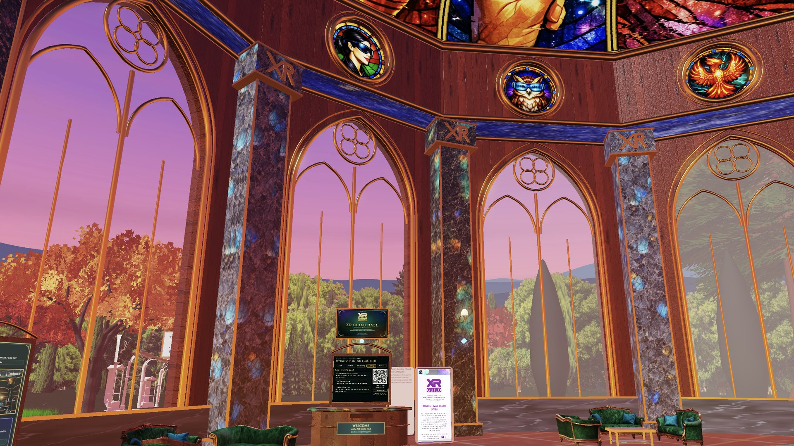
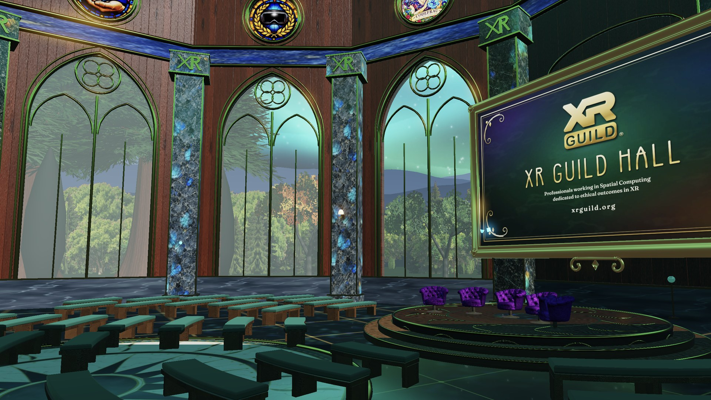
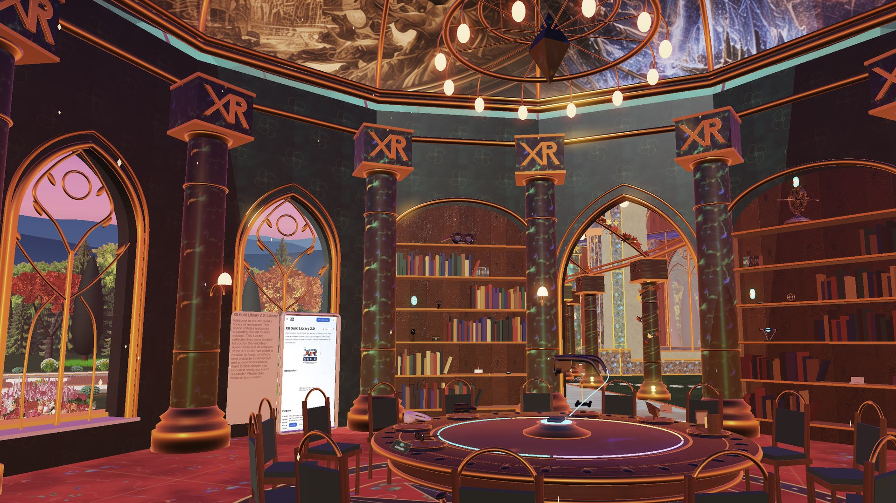
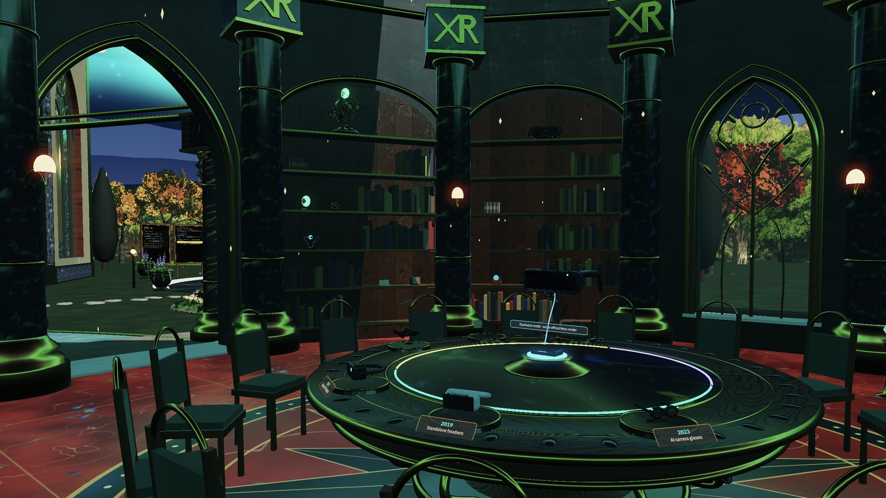
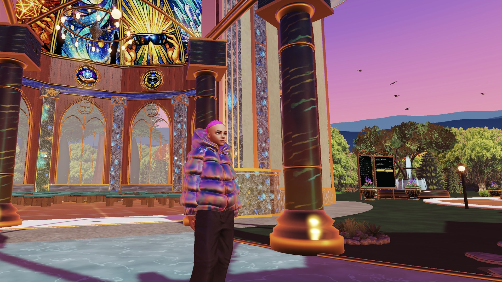

# XR Guild Hall V4 for VIVERSE

V4 brings the art from the Arrival.space build (https://arrival.space/xrguildhall) into the VIVERSE world, on top of everything V3 does: Photon voice and megaphone, seating presets, library search, Timeline of XR, admin and host tools, presenter screen, HLS/RTMP screens and four skies ([V3.md](V3.md)).

Branch: `v4/viverse`, from `main` after V3 was merged.



## Status

| Item | Status | Where |
|---|---|---|
| Welcome screen | Done | `index.html`, `src/social.ts`, `public/welcome.jpg` |
| Quieter garden sound (0.5 to 0.08, about 16 dB) | Done | `src/arrivaladds.ts` |
| One media screen, as in Arrival: the stage screen at Arrival's size and place (9.1 m wide, 1.15 m off the wall); West and East screens removed. V3's media system (idle slide, screenshare, RTMP, HLS) drives it | Done | `src/media.ts`, `src/room.ts`, [docs/MEDIA.md](docs/MEDIA.md) |
| Evo's Arrival art: 98 placements (77 files, 18 MB) from her engine export of 27 Oct 2026, loaded behind the loading screen | Done | `src/arrival.ts`, `public/arrival/`, `scripts/arrival/` |
| V3 geometry the Arrival art replaces is removed (not hidden); V3 keeps its click targets, seating presets, live screen, Connect table and stained glass | Done | `removeV3` in `src/arrival.ts`, `src/main.ts` |
| Collision: Evo's 10 collision meshes join locomotion beside V3's colliders; V3 colliders for things Evo moved are dropped | Done | `src/main.ts` (`Walkable`, `ArrivalColliders`) |
| Stained glass: 12 clerestory windows (inside and out) and the dome lining | Done, ported from Evo's plugins | `src/stainedglass.ts`, `public/stained-glass/` |
| Credits sign spelling (Patrick O'Shaughnessey) | Patched here; Evo to fix the plugin and annotation in Arrival | `scripts/arrival/patches/` |
| Sofas, orrery, succulent planter and picnic set (licences cleared) | Done | `public/arrival/models/` |
| Remixed plugins (fractal trees, insect swarm, splat grass) | Left out | `scripts/arrival/exclude.json` |
| Arrival behaviour: seal hunt, sit-anywhere, library video screen, birdsong and water sounds at Evo's spots | To do: port to three.js | list below |
| Asset validators on the delivered GLBs | Fail: 193 errors (unnamed meshes and materials, triangle and material budgets), 337 warnings | see "Asset standards" |
| Thin the back-edge trees by 20% | To do (Blender) | |
| Headset test (Quest 3/3S) | To do | |

## Welcome screen

1. While loading: the screenshot (`public/welcome.jpg`, any 16:9 JPG) full screen with "Welcome to the XR Guild Hall" and the progress bar.
2. When the world is ready, the Welcome dialog opens over it: the code of conduct, the display name (the visitor's VIVERSE name when signed in, otherwise empty), an "I agree" box, and **Join** / **Enter solo**.
3. Join stays off until there is a name and the box is ticked. Either button fades the screenshot away.

The comfort note that used to be on the loading screen is still in the listing text ([VIVERSE.md](VIVERSE.md)).

## Stained glass

`src/stainedglass.ts` ports Evo's `stainedglasswindow` and `stained-glass-rotunda` plugins (public code and images from the live space, Oct 27 2026). Each clerestory rose gets its window art (unlit, glow 1.36) and a second pane outside, turned to read the right way round, that glows at 0.35 by day and 0.8 under the Aurora and Meteors skies. The dome is lined with 12 gores from a 6 x 2 atlas and an oculus medallion, following the hall dome's own profile; the V3 placeholder dome is hidden once the lining loads. Until the images load, or if they fail, the V3 placeholder glass stays.

Credit to confirm with Evo: one window is `codefrau-stained-glass.webp` (the rose at world position x -7.1, z -12.3).

Known gap, from V3: from outside, a thin strip of the dome interior shows between the top of the wall and the outer dome.

## Bring in the Arrival art

Evo exports the space as an engine package (`XRGuildHall-PlayCanvas`, with `scene/xrguildhall.scene.json`, `models/`, `baked/`, `collision/` and `textures/`). From `guild-hall-library/` (Node 22+; `compress.sh` runs gltf-transform v4 through npx):

```bash
node scripts/arrival/make-manifest.mjs <XRGuildHall-PlayCanvas>
```

It writes `public/arrival/manifest.json` and compresses each file once into `public/arrival/` (WebP textures at 2048 px max + Draco). It keeps every visible model, baked plugin mesh and image panel, and leaves out:

- items hidden in Arrival (alternate bench layouts, cypresses, maples, the swivel chair), markers (portals, gates, spawn) and plugins that only exist as code
- everything in `scripts/arrival/exclude.json`, with the reason for each: remixed plugins, the stained glass (ported), Evo's kiosk and library video screen (static captures whose buttons would not work), and Evo's benches, library chairs and Connect table (V3's own exports, which V3 draws with its seating presets and grabbable devices)

`scripts/arrival/patches/<name>.jpg` replaces the image in that baked GLB before compression. It holds corrections that belong upstream in Arrival (today: the spelling on the credits sign).

### How the two layers fit

Arrival uses this world's coordinates, because Evo's art was first exported from V3. Once the art has loaded, `removeV3` deletes V3's own meshes in the hall, library, colonnade, stage, garden, library interior, desk, notice board and garden additions. Lights stay, and so do:

- every click target (library panels and lanterns, desk panel and plaque, seat hit meshes)
- V3's animated birds (Evo's are a frozen capture)
- the live stage screen, inside Evo's frame, and the stained glass (moved 2 cm in front of the placeholder roses in Evo's hall model)
- V3's seating presets and Connect table, untouched

Where Evo moved things, V3 follows her: the desk panel and plaque stand on Evo's desk at the back of the hall, Evo's principles boards by the colonnade replace V3's pair, and Evo's notice board (with the featured Immersive X event) replaces V3's, opening the calendar when clicked. The mirror floors are off, since Evo's floors are opaque.

Without `public/arrival/manifest.json`, the build is V3 as before.

## Asset standards

`validate_glb.py` (on the `architectural/asset-standards` branch) on the 77 delivered files: 193 errors, 337 warnings.

- Errors: unnamed meshes and materials (mostly baked plugin meshes and collision meshes), and triangle or material budgets exceeded by Evo's art, for example `library-fresco5` 132K and `hall-stone-warm.opt` 110K triangles against 50K for architecture, `colonnade.opt` 68K, `trees-merged` 64K, the orrery 86K and a library sofa 51K against 2K for props, and every flower bed over the prop budget.
- Warnings: WebP not KTX2, compressed geometry, clearcoat and iridescence in use, identical primitives that could be instanced, the same image in several files.

Meeting the budgets means decimating Evo's models, and the budgets wait on the team's choice of minimum target device, so neither is done here. The Draco decoder ships with this build (`public/arrival/draco/`); the validator's meshopt warning does not apply to it.

## Arrival behaviour still to port

The geometry of these plugins is in the build (baked from the live Arrival runtime); what they do is not.

| Plugin | Priority | Note |
|---|---|---|
| xrguildsealhunt | 1 | 8 seals, rose gold #C9897B glow (emissive 1.8); the seals are visible but the hunt does not run |
| sit-anywhere, benchseats | 2 | V3 seating covers the hall and library; Evo's garden benches and stage chairs are not sittable yet |
| xrlibraryscreen | 2 | Click to play the Guild Library video; left out until ported |
| garden-pond, fountain-water, reflecting-pool-water | 3 | Static here. Evo's birds are left out in favour of V3's animated flock. V3's garden sounds still play at V3's spots (the pond moved to x 12, z -38) |
| immersive-x-poster-stand, libraryplacard, xrguild-credits-sign links | 3 | Static here; the sign's Discord and xrguild.org buttons do not click yet |
| guild-library-board, xr-timeline-board, library-shelf-colliders | 3 | Code only in the export; V3's library panels and colliders cover them |
| splat-grass, fractal tree, insectswarm | Left out | Remixed from other creators' Arrival vibes |
| guild-sky-selector, mobile-fullscreen-button, shadow-catcher-fix | Skip | V3 has these, or they are Arrival-only |

## Performance (Arrival build, desktop, Oct 26 2026)

Garden stutter near the pond: about 870 draw calls; `garden-pond` 127 mesh pieces, `LabradoriteFlowerPlanter` 297K triangles, `garden-birds` 42 pieces, about 465 shadow casters. For the port: merge the pond, decimate the planter to about 30K triangles, instance the birds, turn shadows off on small props, warm up garden materials behind the loading screen. GPU texture memory is about 1.2 GB uncompressed; KTX2 is needed before headsets (see the asset standards on loader support first).

## Open decisions for Evo

1. Whether the comfort note goes back on the welcome screen.
2. Whether the seal hunt ships in this VIVERSE build or the next one.
3. Fix the spelling in the credits sign plugin and the space annotation in Arrival (Patrick O'Shaughnessey).

## Put it on VIVERSE

Same as V3 ([V3.md](V3.md#put-it-on-viverse)): Photon Voice SDK in `public/photon/`, App IDs in `.env.local` or `public/guildhall.config.json`, `npm run viverse-zip`, upload in VIVERSE Studio (or `viverse-cli app publish ./dist --app-id <APP_ID>`), microphone permission on. Test desktop, phone and Quest 3/3S with two people before opening it up.

| | |
|---|---|
|  |  |
|  |  |
